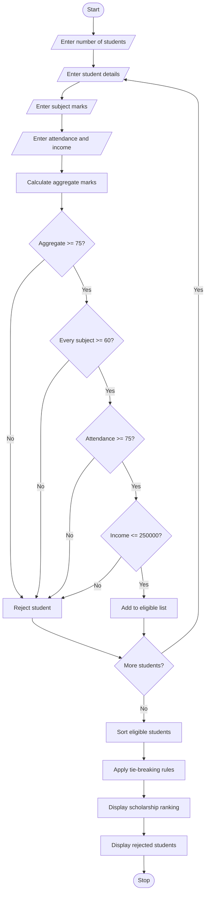

### University Scholarship Allocation System Using Python

### 1\. Problem Statement

The University Scholarship Allocation System is designed to evaluate students who apply for scholarships based on their academic performance, attendance percentage, and family annual income.

The system checks the following eligibility criteria:

* Aggregate Marks: Student must score at least 75%.

* Subject-wise Minimum Marks: Student must score at least 60 marks in every subject.

* Attendance: Student must have at least 75% attendance.

* Family Income: Annual family income must not exceed ₹2,50,000.

After checking eligibility, the system ranks eligible students based on the following tie-breaking rules:

* First priority: Higher aggregate marks.

* Second priority: Higher attendance percentage.

* Third priority: Lower family income.

* Fourth priority: Student ID in ascending order.

Finally, the system displays the list of eligible students according to their ranks.

### 2\. Algorithm

Step 1: Start the program.

Step 2: Read the number of students.

Step 3: Enter student details:

* Student ID

* Student name

* Subject marks

* Attendance percentage

* Annual family income

Step 4: Calculate aggregate percentage.

Step 5: Check eligibility conditions:

* Aggregate marks ≥ 75%.

* Every subject mark ≥ 60.

* Attendance ≥ 75%.

* Annual income ≤ ₹2,50,000.

Step 6: If all conditions are satisfied, add the student to the eligible list.

Step 7: Sort eligible students based on:

* Higher aggregate marks.

* Higher attendance.

* Lower income.

* Student ID.

Step 8: Display eligible students with their ranks.

Step 9: Display rejected students.

Step 10: Stop the program.

### 3\. Flowchart

flowchart TD
    A([Start]) --> B[/Enter number of students/]
    B --> C[/Enter student details/]
    C --> D[/Enter subject marks/]
    D --> E[/Enter attendance and income/]
    E --> F[Calculate aggregate marks]
    F --> G{Aggregate >= 75?}
    G -- No --> H[Reject student]
    G -- Yes --> I{Every subject >= 60?}
    I -- No --> H
    I -- Yes --> J{Attendance >= 75?}
    J -- No --> H
    J -- Yes --> K{Income <= 250000?}
    K -- No --> H
    K -- Yes --> L[Add to eligible list]
    H --> M{More students?}
    L --> M
    M -- Yes --> C
    M -- No --> N[Sort eligible students]
    N --> O[Apply tie-breaking rules]
    O --> P[Display scholarship ranking]
    P --> Q[Display rejected students]
    Q --> R([Stop])

    


### 5\. Sample Input

```text
Enter number of students: 4

Enter details of Student 1
Enter Student ID: A101
Enter Student Name: Ravi
Enter number of subjects: 3
Enter subject 1 marks: 80
Enter subject 2 marks: 85
Enter subject 3 marks: 90
Enter attendance percentage: 92
Enter annual family income: 180000

Enter details of Student 2
Enter Student ID: A102
Enter Student Name: Kumar
Enter number of subjects: 3
Enter subject 1 marks: 80
Enter subject 2 marks: 85
Enter subject 3 marks: 90
Enter attendance percentage: 95
Enter annual family income: 200000

Enter details of Student 3
Enter Student ID: A103
Enter Student Name: Priya
Enter number of subjects: 3
Enter subject 1 marks: 90
Enter subject 2 marks: 85
Enter subject 3 marks: 89
Enter attendance percentage: 80
Enter annual family income: 250000

Enter details of Student 4
Enter Student ID: A104
Enter Student Name: Suresh
Enter number of subjects: 3
Enter subject 1 marks: 55
Enter subject 2 marks: 80
Enter subject 3 marks: 85
Enter attendance percentage: 90
Enter annual family income: 150000
```

### 6\. Sample Output

```text
===== SCHOLARSHIP RANK LIST =====

Rank: 1
Student ID: A103
Name: Priya
Aggregate: 88.0 %
Attendance: 80.0 %
Family Income: Rs. 250000.0

Rank: 2
Student ID: A102
Name: Kumar
Aggregate: 85.0 %
Attendance: 95.0 %
Family Income: Rs. 200000.0

Rank: 3
Student ID: A101
Name: Ravi
Aggregate: 85.0 %
Attendance: 92.0 %
Family Income: Rs. 180000.0

===== REJECTED STUDENTS =====
A104 - Suresh

Program completed successfully.
```

Result: The University Scholarship Allocation System successfully evaluates student eligibility, ranks qualified students, resolves ties using predefined rules, and displays the scholarship rank list.

### 7\. Mermaid Flowchart Code

You can copy this code into the [Mermaid Live Editor](https://mermaid.live/?utm_source=chatgpt.com) to generate the flowchart.



Conclusion: This Python program provides an efficient way to allocate university scholarships by checking academic performance, attendance, and income criteria. It also ensures fair ranking through predefined tie-breaking rules.

