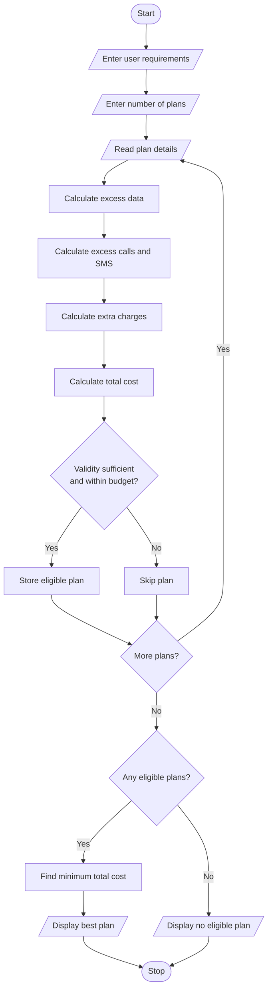

### 5\. Multi-Plan Telecommunications Cost Optimization

### 1\. Problem Statement

Develop a Python program to evaluate multiple mobile recharge plans based on the user's data usage, call minutes, SMS requirements, validity period, and budget.

The program should:

* Accept details of multiple mobile plans.

* Compare plan costs with user requirements.

* Calculate additional charges for excess data, calls, and SMS.

* Check validity and budget constraints.

* Identify the most economical eligible plan.

* Display the final recommended plan and its total cost.

### 2\. Algorithm

* Start the program.

* Get the number of mobile plans.

* Read the user's data, call minutes, SMS, validity, and budget requirements.

* Read the details of each mobile plan.

* Calculate excess data, call minutes, and SMS.

* Calculate additional charges.

* Calculate the total cost of each plan.

* Check whether the plan satisfies validity and budget constraints.

* Compare all eligible plans.

* Select the plan with the lowest total cost.

* Display the recommended plan and its total cost.

* If no plan is eligible, display a suitable message.

* Stop.

### 3\. Flowchart
TELECOMMUNICATION PLAN OPTIMIZATION

Enter required data (GB): 2
Enter required call minutes: 500
Enter required SMS count: 100
Enter required validity (days): 28
Enter your budget (Rs): 300

Enter number of mobile plans: 3

Enter details of Plan 1
Plan name: Basic
Plan price (Rs): 199
Data limit (GB): 1.5
Call minutes: 400
SMS limit: 100
Validity (days): 28

Enter details of Plan 2
Plan name: Smart
Plan price (Rs): 249
Data limit (GB): 2
Call minutes: 500
SMS limit: 100
Validity (days): 28

Enter details of Plan 3
Plan name: Premium
Plan price (Rs): 349
Data limit (GB): 3
Call minutes: 600
SMS limit: 100
Validity (days): 56

### 4\. Python Source Code

```python

# Multi-Plan Telecommunications Cost Optimization

print("TELECOMMUNICATION PLAN OPTIMIZATION")

# User requirements
data_required = float(input("Enter required data (GB): "))
calls_required = int(input("Enter required call minutes: "))
sms_required = int(input("Enter required SMS count: "))
validity_required = int(input("Enter required validity (days): "))
budget = float(input("Enter your budget (Rs): "))

n = int(input("\nEnter number of mobile plans: "))

plans = []

for i in range(n):
    print(f"\nEnter details of Plan {i + 1}")

    name = input("Plan name: ")
    price = float(input("Plan price (Rs): "))
    data = float(input("Data limit (GB): "))
    calls = int(input("Call minutes: "))
    sms = int(input("SMS limit: "))
    validity = int(input("Validity (days): "))

    # Additional charges
    data_rate = 10
    call_rate = 0.50
    sms_rate = 0.25

    # Calculate excess usage
    extra_data = max(0, data_required - data)
    extra_calls = max(0, calls_required - calls)
    extra_sms = max(0, sms_required - sms)

    # Calculate extra charges
    extra_charge = (
        extra_data * data_rate
        + extra_calls * call_rate
        + extra_sms * sms_rate
    )

    total_cost = price + extra_charge

    # Check eligibility
    if validity >= validity_required and total_cost <= budget:
        plans.append((name, total_cost, price, extra_charge))

# Find economical plan
if plans:
    best_plan = min(plans, key=lambda x: x[1])

    print("\n----- RECOMMENDED PLAN -----")
    print("Plan Name:", best_plan[0])
    print("Base Price: Rs.", best_plan[2])
    print("Extra Charges: Rs.", best_plan[3])
    print("Total Cost: Rs.", best_plan[1])
    print("Status: Eligible")
else:
    print("\nNo eligible plan found!")
    print("Please increase your budget or modify requirements.")
```

### 5\. Sample Input

```text
TELECOMMUNICATION PLAN OPTIMIZATION

Enter required data (GB): 2
Enter required call minutes: 500
Enter required SMS count: 100
Enter required validity (days): 28
Enter your budget (Rs): 300

Enter number of mobile plans: 3

Enter details of Plan 1
Plan name: Basic
Plan price (Rs): 199
Data limit (GB): 1.5
Call minutes: 400
SMS limit: 100
Validity (days): 28

Enter details of Plan 2
Plan name: Smart
Plan price (Rs): 249
Data limit (GB): 2
Call minutes: 500
SMS limit: 100
Validity (days): 28

Enter details of Plan 3
Plan name: Premium
Plan price (Rs): 349
Data limit (GB): 3
Call minutes: 600
SMS limit: 100
Validity (days): 56
```

### 6\. Sample Output

```text
----- RECOMMENDED PLAN -----

Plan Name: Smart
Base Price: Rs. 249.0
Extra Charges: Rs. 0.0
Total Cost: Rs. 249.0
Status: Eligible
```

### 7\. Mermaid Flowchart Code



Result: The Python program successfully compares multiple telecommunications plans, calculates excess usage charges, checks budget and validity constraints, and identifies the most economical eligible mobile plan.
