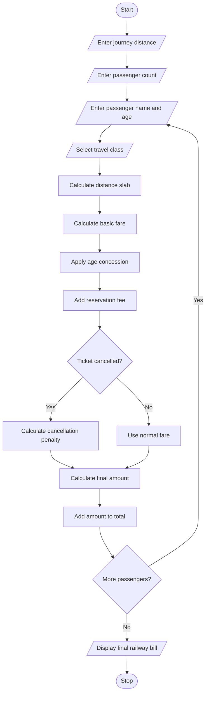

### 6\. Railway Fare and Reservation Calculator

### 1\. Problem Statement

Develop a Python program to calculate railway ticket fares for multiple passengers based on distance slabs, travel classes, age-based concessions, reservation fees, and cancellation penalties.

The program should:

* Accept passenger details such as name and age.

* Accept journey distance and travel class.

* Calculate fare based on distance.

* Apply age-based concessions.

* Add reservation charges.

* Calculate the total fare for all passengers.

* Calculate cancellation penalties when a ticket is cancelled.

* Display the final railway fare statement.

### 2\. Algorithm

* Start the program.

* Enter the journey distance.

* Enter the number of passengers.

* Read each passenger's name and age.

* Select the travel class.

* Calculate the basic fare using distance slabs.

* Apply age-based concessions.

* Add reservation charges.

* Calculate the final fare for each passenger.

* Ask whether the ticket is cancelled.

* If cancelled, calculate the cancellation penalty.

* Display passenger-wise fare details and total fare.

* Stop.

### 3\. Flowchart
flowchart TD
    A([Start]) --> B[/Enter journey distance/]
    B --> C[/Enter passenger count/]
    C --> D[/Enter passenger name and age/]
    D --> E[/Select travel class/]
    E --> F[Calculate distance slab]
    F --> G[Calculate basic fare]
    G --> H[Apply age concession]
    H --> I[Add reservation fee]
    I --> J{Ticket cancelled?}
    J -- Yes --> K[Calculate cancellation penalty]
    J -- No --> L[Use normal fare]
    K --> M[Calculate final amount]
    L --> M
    M --> N[Add amount to total]
    N --> O{More passengers?}
    O -- Yes --> D
    O -- No --> P[/Display final railway bill/]
    P --> Q([Stop])
### 4\. Python Source Code

```python

# Railway Fare and Reservation Calculator

print("RAILWAY FARE CALCULATOR")

distance = float(input("Enter journey distance (km): "))
n = int(input("Enter number of passengers: "))

total_fare = 0
total_penalty = 0

for i in range(n):

    print("\nPassenger", i + 1)

    name = input("Enter passenger name: ")
    age = int(input("Enter age: "))

    print("\nTravel Classes")
    print("1. Sleeper - Rs. 1.50/km")
    print("2. AC 3 Tier - Rs. 2.50/km")
    print("3. AC 2 Tier - Rs. 3.50/km")

    choice = int(input("Select class (1-3): "))

    if choice == 1:
        rate = 1.50
        reservation = 20
        class_name = "Sleeper"

    elif choice == 2:
        rate = 2.50
        reservation = 40
        class_name = "AC 3 Tier"

    elif choice == 3:
        rate = 3.50
        reservation = 50
        class_name = "AC 2 Tier"

    else:
        print("Invalid class selection")
        continue

    # Distance slab charges
    if distance <= 100:
        slab_charge = 0
    elif distance <= 500:
        slab_charge = 50
    else:
        slab_charge = 100

    basic_fare = distance * rate + slab_charge

    # Age-based concession
    concession = 0

    if age < 5:
        concession = basic_fare
    elif age >= 60:
        concession = basic_fare * 0.20

    fare = basic_fare - concession + reservation

    print("\nPassenger Name:", name)
    print("Travel Class:", class_name)
    print("Basic Fare: Rs.", round(basic_fare, 2))
    print("Concession: Rs.", round(concession, 2))
    print("Reservation Fee: Rs.", reservation)

    cancel = input("Cancel ticket? (yes/no): ").lower()

    if cancel == "yes":
        penalty = fare * 0.25
        payable = penalty
        total_penalty += penalty
        print("Cancellation Penalty: Rs.", round(penalty, 2))
    else:
        payable = fare
        print("Ticket Confirmed")

    print("Final Amount: Rs.", round(payable, 2))

    total_fare += payable

print("\n----- FINAL RAILWAY BILL -----")
print("Total Passengers:", n)
print("Total Cancellation Penalty: Rs.",
      round(total_penalty, 2))
print("Total Amount: Rs.", round(total_fare, 2))
print("Thank You!")
```

Note: The fare rates, concessions, reservation fees, and cancellation penalty are illustrative values for this programming exercise, not official Indian Railways tariff rules.

### 5\. Sample Input

```text
RAILWAY FARE CALCULATOR

Enter journey distance (km): 200
Enter number of passengers: 2

Passenger 1
Enter passenger name: Ravi
Enter age: 65

Travel Classes
1. Sleeper - Rs. 1.50/km
2. AC 3 Tier - Rs. 2.50/km
3. AC 2 Tier - Rs. 3.50/km

Select class (1-3): 1
Cancel ticket? (yes/no): no

Passenger 2
Enter passenger name: Kumar
Enter age: 25
Select class (1-3): 2
Cancel ticket? (yes/no): yes
```

### 6\. Sample Output

```text
Passenger Name: Ravi
Travel Class: Sleeper
Basic Fare: Rs. 350.0
Concession: Rs. 70.0
Reservation Fee: Rs. 20
Ticket Confirmed
Final Amount: Rs. 300.0

Passenger Name: Kumar
Travel Class: AC 3 Tier
Basic Fare: Rs. 550.0
Concession: Rs. 0.0
Reservation Fee: Rs. 40
Cancellation Penalty: Rs. 147.5
Final Amount: Rs. 147.5

----- FINAL RAILWAY BILL -----
Total Passengers: 2
Total Cancellation Penalty: Rs. 147.5
Total Amount: Rs. 447.5

Thank You!
```

### 7\. Mermaid Flowchart Code



Result: The Python program calculates railway fares for multiple passengers, applies age-based concessions, adds reservation fees, calculates cancellation penalties, and displays the final payable amount.
