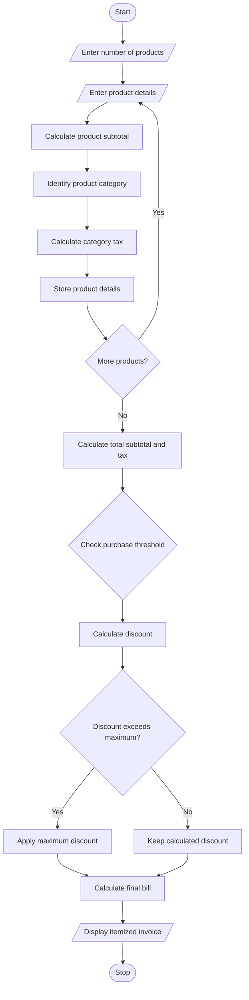

### 7\. Retail Billing with Multiple Discount Rules

### 1\. Problem Statement

Develop a Python program to generate a retail bill for multiple products based on product price, quantity, category-specific taxes, threshold discounts, and maximum concession limits.

The program should:

* Accept multiple product names, prices, quantities, and categories.

* Calculate the subtotal for each product.

* Apply category-specific taxes.

* Provide discounts based on purchase amount.

* Apply a maximum discount limit.

* Calculate the final payable amount.

* Generate an itemized invoice displaying all details.

### 2\. Algorithm

* Start the program.

* Read the number of products.

* Enter product name, price, quantity, and category.

* Calculate the subtotal of each product.

* Calculate the total purchase amount.

* Apply category-specific taxes.

* Check discount eligibility based on purchase thresholds.

* Calculate the discount amount.

* Apply the maximum concession limit.

* Calculate the final bill amount.

* Display the itemized invoice.

* Stop the program.

### 3\. Flowchart
### 7\. Retail Billing with Multiple Discount Rules

### 1\. Problem Statement

Develop a Python program to generate a retail bill for multiple products based on product price, quantity, category-specific taxes, threshold discounts, and maximum concession limits.

The program should:

* Accept multiple product names, prices, quantities, and categories.

* Calculate the subtotal for each product.

* Apply category-specific taxes.

* Provide discounts based on purchase amount.

* Apply a maximum discount limit.

* Calculate the final payable amount.

* Generate an itemized invoice displaying all details.

### 2\. Algorithm

* Start the program.

* Read the number of products.

* Enter product name, price, quantity, and category.

* Calculate the subtotal of each product.

* Calculate the total purchase amount.

* Apply category-specific taxes.

* Check discount eligibility based on purchase thresholds.

* Calculate the discount amount.

* Apply the maximum concession limit.

* Calculate the final bill amount.

* Display the itemized invoice.

* Stop the program.

### 3\. Flowchart


### 4\. Python Source Code

```python

# Retail Billing with Multiple Discount Rules

print("===== RETAIL BILLING SYSTEM =====")

n = int(input("Enter number of products: "))

items = []
subtotal = 0
total_tax = 0

for i in range(n):

    print("\nProduct", i + 1)

    name = input("Enter product name: ")
    price = float(input("Enter product price: "))
    quantity = int(input("Enter quantity: "))
    category = input("Enter category (food/clothing/electronics): ").lower()

    amount = price * quantity

    # Category-specific tax
    if category == "food":
        tax_rate = 5
    elif category == "clothing":
        tax_rate = 5
    elif category == "electronics":
        tax_rate = 18
    else:
        tax_rate = 12

    tax = amount * tax_rate / 100

    items.append((name, quantity, price, amount,
                  tax_rate, tax))

    subtotal += amount
    total_tax += tax

# Threshold-based discount
if subtotal >= 5000:
    discount_rate = 20
elif subtotal >= 3000:
    discount_rate = 15
elif subtotal >= 1000:
    discount_rate = 10
else:
    discount_rate = 0

discount = subtotal * discount_rate / 100

# Maximum concession limit
max_discount = 1000

if discount > max_discount:
    discount = max_discount

# Final bill calculation
final_amount = subtotal + total_tax - discount

# Display invoice
print("\n========== ITEMIZED INVOICE ==========")

print("Product\tQty\tPrice\tAmount\tTax")

for item in items:
    print(item[0], "\t", item[1], "\t",
          item[2], "\t", item[3], "\t",
          str(item[4]) + "%")

print("--------------------------------------")
print("Subtotal: Rs.", round(subtotal, 2))
print("Total Tax: Rs.", round(total_tax, 2))
print("Discount Rate:", discount_rate, "%")
print("Discount Amount: Rs.", round(discount, 2))
print("Maximum Discount: Rs.", max_discount)
print("--------------------------------------")
print("Final Amount: Rs.", round(final_amount, 2))
print("======================================")
print("Thank You! Visit Again.")
```

### 5\. Sample Input

```text
===== RETAIL BILLING SYSTEM =====

Enter number of products: 3

Product 1
Enter product name: Rice
Enter product price: 100
Enter quantity: 10
Enter category (food/clothing/electronics): food

Product 2
Enter product name: Shirt
Enter product price: 500
Enter quantity: 2
Enter category (food/clothing/electronics): clothing

Product 3
Enter product name: Headphones
Enter product price: 2000
Enter quantity: 1
Enter category (food/clothing/electronics): electronics
```

### 6\. Sample Output

```text
========== ITEMIZED INVOICE ==========

Product   Qty   Price   Amount   Tax

Rice       10    100     1000     5%
Shirt       2    500     1000     5%
Headphones  1   2000     2000    18%

--------------------------------------
Subtotal: Rs. 4000.0
Total Tax: Rs. 460.0
Discount Rate: 15 %
Discount Amount: Rs. 600.0
Maximum Discount: Rs. 1000
--------------------------------------
Final Amount: Rs. 3860.0
======================================
Thank You! Visit Again.
```

### 7\. Mermaid Flowchart Code



Result: The Python program successfully processes multiple products, calculates category-specific taxes, applies threshold-based discounts and maximum concession limits, and generates an itemized retail invoice.

### 4\. Python Source Code

```python

# Retail Billing with Multiple Discount Rules

print("===== RETAIL BILLING SYSTEM =====")

n = int(input("Enter number of products: "))

items = []
subtotal = 0
total_tax = 0

for i in range(n):

    print("\nProduct", i + 1)

    name = input("Enter product name: ")
    price = float(input("Enter product price: "))
    quantity = int(input("Enter quantity: "))
    category = input("Enter category (food/clothing/electronics): ").lower()

    amount = price * quantity

    # Category-specific tax
    if category == "food":
        tax_rate = 5
    elif category == "clothing":
        tax_rate = 5
    elif category == "electronics":
        tax_rate = 18
    else:
        tax_rate = 12

    tax = amount * tax_rate / 100

    items.append((name, quantity, price, amount,
                  tax_rate, tax))

    subtotal += amount
    total_tax += tax

# Threshold-based discount
if subtotal >= 5000:
    discount_rate = 20
elif subtotal >= 3000:
    discount_rate = 15
elif subtotal >= 1000:
    discount_rate = 10
else:
    discount_rate = 0

discount = subtotal * discount_rate / 100

# Maximum concession limit
max_discount = 1000

if discount > max_discount:
    discount = max_discount

# Final bill calculation
final_amount = subtotal + total_tax - discount

# Display invoice
print("\n========== ITEMIZED INVOICE ==========")

print("Product\tQty\tPrice\tAmount\tTax")

for item in items:
    print(item[0], "\t", item[1], "\t",
          item[2], "\t", item[3], "\t",
          str(item[4]) + "%")

print("--------------------------------------")
print("Subtotal: Rs.", round(subtotal, 2))
print("Total Tax: Rs.", round(total_tax, 2))
print("Discount Rate:", discount_rate, "%")
print("Discount Amount: Rs.", round(discount, 2))
print("Maximum Discount: Rs.", max_discount)
print("--------------------------------------")
print("Final Amount: Rs.", round(final_amount, 2))
print("======================================")
print("Thank You! Visit Again.")
```

### 5\. Sample Input

```text
===== RETAIL BILLING SYSTEM =====

Enter number of products: 3

Product 1
Enter product name: Rice
Enter product price: 100
Enter quantity: 10
Enter category (food/clothing/electronics): food

Product 2
Enter product name: Shirt
Enter product price: 500
Enter quantity: 2
Enter category (food/clothing/electronics): clothing

Product 3
Enter product name: Headphones
Enter product price: 2000
Enter quantity: 1
Enter category (food/clothing/electronics): electronics
```

### 6\. Sample Output

```text
========== ITEMIZED INVOICE ==========

Product   Qty   Price   Amount   Tax

Rice       10    100     1000     5%
Shirt       2    500     1000     5%
Headphones  1   2000     2000    18%

--------------------------------------
Subtotal: Rs. 4000.0
Total Tax: Rs. 460.0
Discount Rate: 15 %
Discount Amount: Rs. 600.0
Maximum Discount: Rs. 1000
--------------------------------------
Final Amount: Rs. 3860.0
======================================
Thank You! Visit Again.
```

### 7\. Mermaid Flowchart Code


Result: The Python program successfully processes multiple products, calculates category-specific taxes, applies threshold-based discounts and maximum concession limits, and generates an itemized retail invoice.
