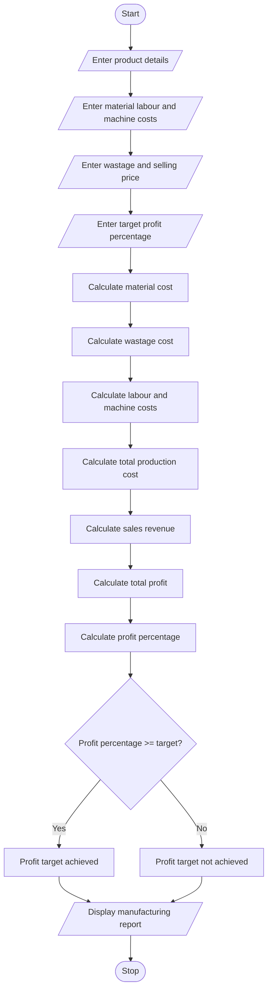

### 8\. Manufacturing Cost and Profitability Analysis

### 1\. Problem Statement

Develop a Python program to calculate manufacturing costs and analyze product profitability based on material costs, labour charges, wastage, machine costs, and selling prices.

The program should:

* Accept product name and production quantity.

* Calculate total raw material costs.

* Calculate labour charges.

* Calculate material wastage costs.

* Calculate machine operating costs.

* Determine the total production cost.

* Calculate the selling price and total profit.

* Compare the actual profit percentage with the specified profit target.

* Display whether production meets the required profit target.

### 2\. Algorithm

* Start the program.

* Enter product name and production quantity.

* Enter raw material cost per unit.

* Enter labour charge per unit.

* Enter wastage percentage.

* Enter machine cost per unit.

* Enter selling price per unit.

* Enter the required profit percentage.

* Calculate total material cost.

* Calculate wastage cost.

* Calculate total labour and machine costs.

* Calculate total production cost.

* Calculate total selling revenue.

* Calculate total profit and profit percentage.

* Compare actual profit percentage with the target.

* Display the manufacturing cost and profitability report.

* Stop.

### 3\. Flowchart
flowchart TD
    A([Start]) --> B[/Enter product details/]
    B --> C[/Enter material labour and machine costs/]
    C --> D[/Enter wastage and selling price/]
    D --> E[/Enter target profit percentage/]
    E --> F[Calculate material cost]
    F --> G[Calculate wastage cost]
    G --> H[Calculate labour and machine costs]
    H --> I[Calculate total production cost]
    I --> J[Calculate sales revenue]
    J --> K[Calculate total profit]
    K --> L[Calculate profit percentage]
    L --> M{Profit percentage >= target?}
    M -- Yes --> N[Profit target achieved]
    M -- No --> O[Profit target not achieved]
    N --> P[/Display manufacturing report/]
    O --> P
    P --> Q([Stop])
### 4\. Python Source Code

```python

# Manufacturing Cost and Profitability Analysis

print("===== MANUFACTURING COST ANALYSIS =====")

# Input details
product = input("Enter product name: ")
quantity = int(input("Enter production quantity: "))

material_cost = float(input("Enter material cost per unit: "))
labour_cost = float(input("Enter labour cost per unit: "))
wastage_percent = float(input("Enter wastage percentage: "))
machine_cost = float(input("Enter machine cost per unit: "))
selling_price = float(input("Enter selling price per unit: "))
profit_target = float(input("Enter target profit percentage: "))

# Calculate material cost
total_material = material_cost * quantity

# Calculate wastage cost
wastage_cost = total_material * wastage_percent / 100

# Calculate labour cost
total_labour = labour_cost * quantity

# Calculate machine cost
total_machine = machine_cost * quantity

# Calculate total production cost
total_cost = (
    total_material +
    wastage_cost +
    total_labour +
    total_machine
)

# Calculate sales revenue
revenue = selling_price * quantity

# Calculate profit
profit = revenue - total_cost

# Calculate profit percentage
if total_cost > 0:
    profit_percent = (profit / total_cost) * 100
else:
    profit_percent = 0

# Display report
print("\n===== MANUFACTURING REPORT =====")

print("Product Name:", product)
print("Production Quantity:", quantity)

print("\n----- COST DETAILS -----")
print("Material Cost: Rs.", round(total_material, 2))
print("Wastage Cost: Rs.", round(wastage_cost, 2))
print("Labour Cost: Rs.", round(total_labour, 2))
print("Machine Cost: Rs.", round(total_machine, 2))

print("\nTotal Production Cost: Rs.", round(total_cost, 2))
print("Total Sales Revenue: Rs.", round(revenue, 2))
print("Total Profit: Rs.", round(profit, 2))
print("Profit Percentage:", round(profit_percent, 2), "%")

# Check profit target
print("\n----- PROFITABILITY STATUS -----")

if profit_percent >= profit_target:
    print("Target Profit Percentage:", profit_target, "%")
    print("Status: PROFIT TARGET ACHIEVED")
else:
    print("Target Profit Percentage:", profit_target, "%")
    print("Status: PROFIT TARGET NOT ACHIEVED")

print("===============================")
```

### 5\. Sample Input

```text
===== MANUFACTURING COST ANALYSIS =====

Enter product name: Chair
Enter production quantity: 100

Enter material cost per unit: 500
Enter labour cost per unit: 100
Enter wastage percentage: 5
Enter machine cost per unit: 50
Enter selling price per unit: 800
Enter target profit percentage: 15
```

### 6\. Sample Output

```text
===== MANUFACTURING REPORT =====

Product Name: Chair
Production Quantity: 100

----- COST DETAILS -----
Material Cost: Rs. 50000.0
Wastage Cost: Rs. 2500.0
Labour Cost: Rs. 10000.0
Machine Cost: Rs. 5000.0

Total Production Cost: Rs. 67500.0
Total Sales Revenue: Rs. 80000.0
Total Profit: Rs. 12500.0
Profit Percentage: 18.52 %

----- PROFITABILITY STATUS -----
Target Profit Percentage: 15.0 %
Status: PROFIT TARGET ACHIEVED
===============================
```

### 7\. Mermaid Flowchart Code



Result: The Python program successfully calculates material costs, labour charges, wastage costs, machine expenses, total production costs, sales revenue, and profit percentage. It also determines whether the manufacturing process achieves the specified profit target.
