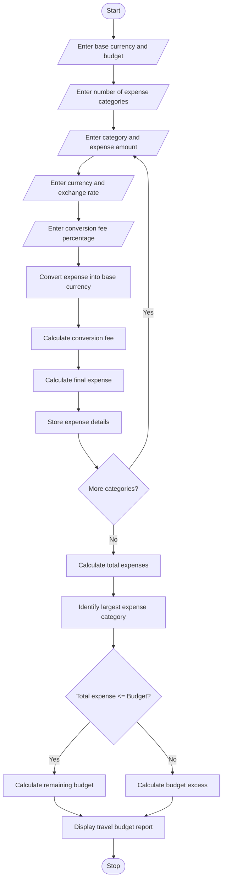

### 9\. Multi-Currency Travel Budget Analysis

### 1\. Problem Statement

Develop a Python program to analyze travel expenses in multiple currencies by converting them into a selected base currency using supplied exchange rates.

The program should:

* Accept multiple travel expense categories.

* Read expense amounts in different currencies.

* Convert expenses using supplied exchange rates.

* Calculate currency conversion fees.

* Calculate total travel expenses.

* Compare total expenses against the planned budget.

* Identify the largest expense category.

* Display a detailed travel budget report.

### 2\. Algorithm

* Start the program.

* Enter the base currency.

* Enter the travel budget.

* Enter the number of expense categories.

* Read the category name and expense amount.

* Enter the foreign currency code.

* Enter the exchange rate.

* Enter the currency conversion fee percentage.

* Convert the expense into the base currency.

* Calculate the conversion fee.

* Calculate the total expense including fees.

* Add all expenses.

* Identify the largest expense category.

* Compare total expenses with the planned budget.

* Display the travel budget report.

* Stop.

### 3\. Flowchart
flowchart TD
    A([Start]) --> B[/Enter base currency and budget/]
    B --> C[/Enter number of expense categories/]
    C --> D[/Enter category and expense amount/]
    D --> E[/Enter currency and exchange rate/]
    E --> F[/Enter conversion fee percentage/]
    F --> G[Convert expense into base currency]
    G --> H[Calculate conversion fee]
    H --> I[Calculate final expense]
    I --> J[Store expense details]
    J --> K{More categories?}
    K -- Yes --> D
    K -- No --> L[Calculate total expenses]
    L --> M[Identify largest expense category]
    M --> N{Total expense <= Budget?}
    N -- Yes --> O[Calculate remaining budget]
    N -- No --> P[Calculate budget excess]
    O --> Q[Display travel budget report]
    P --> Q
    Q --> R([Stop])

### 4\. Python Source Code

```python

# Multi-Currency Travel Budget Analysis

print("===== TRAVEL BUDGET ANALYSIS =====")

# Input base currency and budget
base_currency = input("Enter base currency (e.g. INR): ").upper()

budget = float(input("Enter planned travel budget: "))

n = int(input("Enter number of expense categories: "))

expenses = []
total_expense = 0

for i in range(n):

    print("\nExpense Category", i + 1)

    category = input("Enter category name: ")

    amount = float(input("Enter expense amount: "))

    currency = input("Enter currency code: ").upper()

    rate = float(input("Enter exchange rate: "))

    fee_percent = float(input("Enter conversion fee (%): "))

    # Currency conversion
    converted_amount = amount * rate

    # Calculate conversion fee
    conversion_fee = converted_amount * fee_percent / 100

    # Calculate final expense
    final_amount = converted_amount + conversion_fee

    expenses.append((category, converted_amount,
                     conversion_fee, final_amount))

    total_expense += final_amount

# Identify largest expense category
largest_expense = max(expenses, key=lambda x: x[3])

# Calculate remaining budget
balance = budget - total_expense

# Display report
print("\n===== TRAVEL EXPENSE REPORT =====")

print("Base Currency:", base_currency)

for item in expenses:
    print("\nCategory:", item[0])
    print("Converted Amount:", round(item[1], 2))
    print("Conversion Fee:", round(item[2], 2))
    print("Total Expense:", round(item[3], 2),
          base_currency)

print("\n--------------------------------")
print("Total Travel Expense:",
      round(total_expense, 2), base_currency)

print("Largest Expense Category:",
      largest_expense[0])

print("Largest Expense Amount:",
      round(largest_expense[3], 2), base_currency)

print("Planned Budget:",
      round(budget, 2), base_currency)

if total_expense <= budget:
    print("Budget Status: WITHIN BUDGET")
    print("Remaining Budget:", round(balance, 2),
          base_currency)
else:
    print("Budget Status: BUDGET EXCEEDED")
    print("Extra Amount:", round(abs(balance), 2),
          base_currency)

print("================================")
```

### 5\. Sample Input

```text
===== TRAVEL BUDGET ANALYSIS =====

Enter base currency (e.g. INR): INR
Enter planned travel budget: 100000
Enter number of expense categories: 3

Expense Category 1
Enter category name: Hotel
Enter expense amount: 300
Enter currency code: USD
Enter exchange rate: 85
Enter conversion fee (%): 2

Expense Category 2
Enter category name: Food
Enter expense amount: 200
Enter currency code: EUR
Enter exchange rate: 90
Enter conversion fee (%): 2

Expense Category 3
Enter category name: Shopping
Enter expense amount: 100
Enter currency code: USD
Enter exchange rate: 85
Enter conversion fee (%): 1
```

### 6\. Sample Output

```text
===== TRAVEL EXPENSE REPORT =====

Base Currency: INR

Category: Hotel
Converted Amount: 25500.0
Conversion Fee: 510.0
Total Expense: 26010.0 INR

Category: Food
Converted Amount: 18000.0
Conversion Fee: 360.0
Total Expense: 18360.0 INR

Category: Shopping
Converted Amount: 8500.0
Conversion Fee: 85.0
Total Expense: 8585.0 INR

--------------------------------
Total Travel Expense: 52955.0 INR

Largest Expense Category: Hotel
Largest Expense Amount: 26010.0 INR

Planned Budget: 100000.0 INR

Budget Status: WITHIN BUDGET
Remaining Budget: 47045.0 INR

================================
```

### 7\. Mermaid Flowchart Code



Result: The Python program successfully converts expenses from multiple currencies into a base currency, calculates conversion fees, compares spending against the planned budget, and identifies the largest expense category.

Note: The exchange rates in the sample are illustrative values. Enter the applicable exchange rates when running the program.
